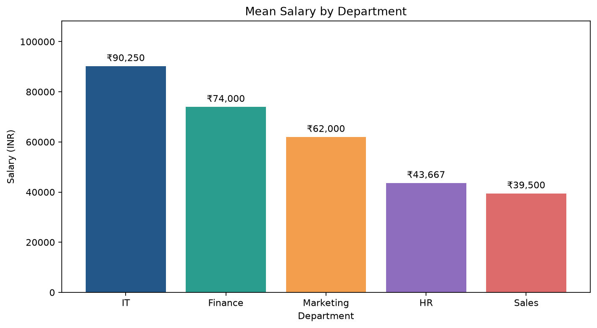
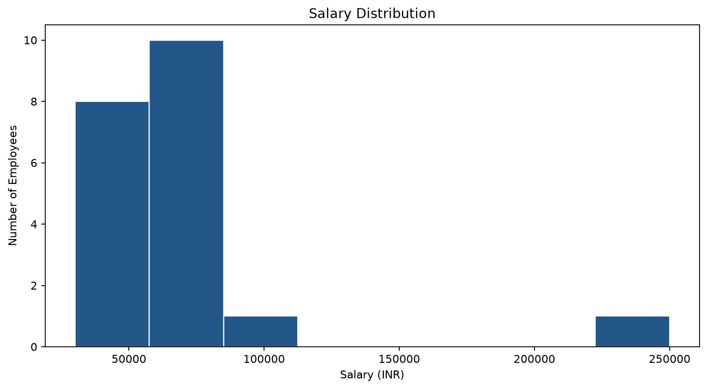
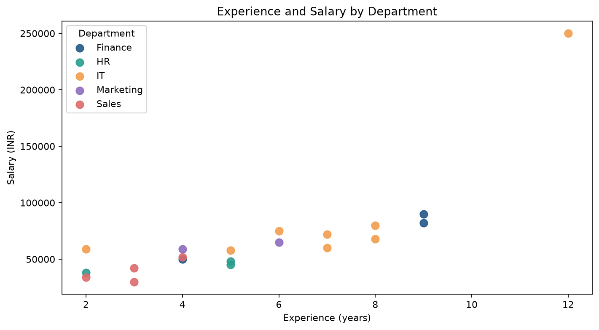
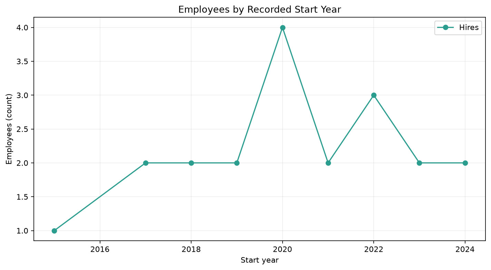
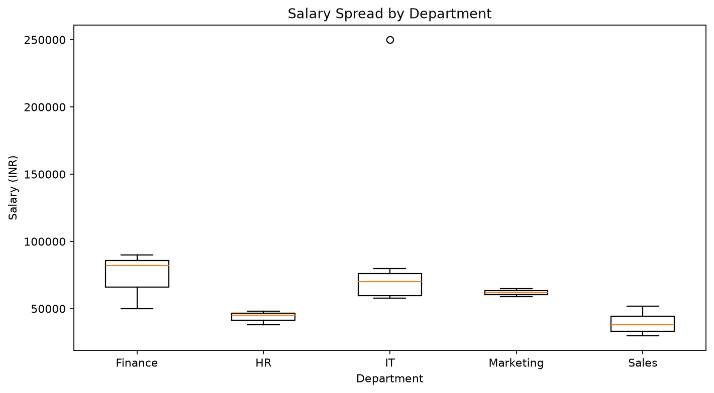

# Five Charts and Their Insights

*Synthetic demonstration data.*

## Chart 1

**Insight:** Highest mean salary is in IT (INR 90,250).

## Chart 2

**Insight:** Median salary is INR 59,000; flagged IQR outliers: 1.

## Chart 3

**Insight:** Experience and salary are compared by department; the high salary outlier needs review.

## Chart 4

**Insight:** The largest recorded hiring cohort is 2020 with 4 employees; one date was imputed.

## Chart 5

**Insight:** Salary varies across departments; unusually high values should be validated before removal.
